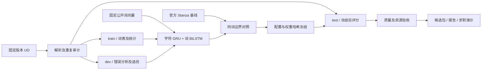

# 实现与实验数据流

`src/uyghur_pos` 提供数据、模型、训练、评测和推理；`scripts` 提供实验管理、正式评测与打包；`reports` 记录假设及证据。私有 SSH 凭据不参与任何训练或发行包。

所有模型输入为预分词的词序列。字符编码不改变词边界；padding 只用于批处理，句子／字符循环网络都使用长度感知的 packing，避免 padding 影响双向表示。损失忽略填充位置。

同一统计口径贯穿所有模型，OOV 始终按标注 train 定义；外部词向量词典的覆盖不改变这个定义。性能报告区分纯训练时间、完整运行时间、冷启动、预热后延迟和绝对峰值内存。

正式评分之前冻结所有候选、对照、种子、发行权重和输入哈希。评分之后不覆盖结果或回头改门槛；实现修复若影响测试，必须另作受污染评测记录。
